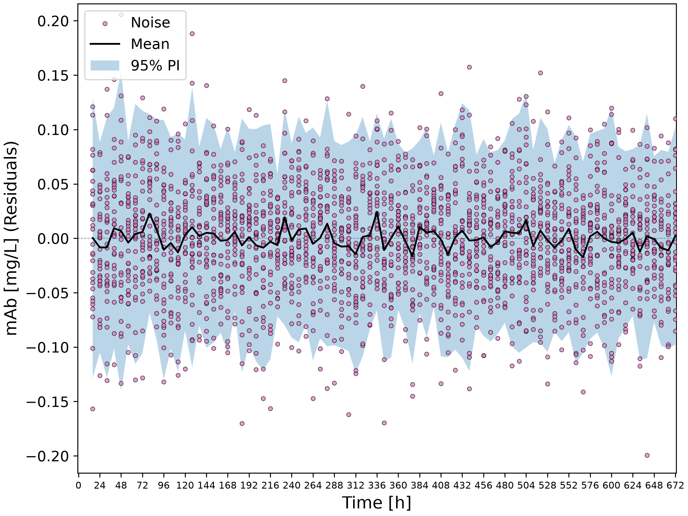

# Machine Learning Model for Optimizing Monoclonal Antibody Production

This project develops a machine learning model using Python that determines the optimal 
initial conditions that would maximize the space-time profit of a Monoclonal antibody(mAb) production process 
by predicting process dynamics across 30 batch datasets.

The system simultaneously evaluates glucose concentration, glutamine concentration, viable cell density (VCD), and harvest time 
using non-linear vector auto-regression (NVAR), accounting for how the parameters affect one another. 
The model can determine the best initial conditions to maximize space-time profit, saving both time and money.

## Highlights

- Developed NVAR models using polynomial and k-nearest neighbors (*k*-NN) regression pipelines.
- Implemented cross-validation hyperparameter optimization using `GridSearchCV` and `GroupKFold` to evaluate lag orders (*p*) and regression parameters.
- Simulated forecasting to estimate prediction intervals for cell culture value, space-time profit and space-time yield through repeated simulations.
- Evaluated residuals of the NVAR models to verify model fit and the white-noise error assumptions.
- Optimized initial culture conditions and exported summary figures and CSV summary tables.

## Environment

- Python (v3.14.7)
- pandas (v3.0.6)
- matplotlib (v3.11.0)
- numpy (2.5.2)
- scikit-learn (1.9.0)
- scipy (1.18.0)

## Code Design

### Data Loading
This stage begins with importing and organizing the batch dataset csv files and initial conditions CSV file into unified, structured DataFrames (`df_combined` and `df_ic_all` respectfully) using the `data_loading` function.

This stage is necessary because the individual batch conditions CSV file must be programmatically parsed and filtered to match only the selected subset of batch runs. 
Additionally, batch datasets are combined so that data is centralized and to prevent clutter and future bottlenecks. 

By feeding clean, aligned DataFrames into memory, this stage acts as the foundation for the entire pipeline, ensuring that subsequent preprocessing, feature engineering, and cross-validation stages operate efficiently without unnecessary file management.

### Preprocessing
This stage transforms the batch DataFrame into past state (lagged values) feature arrays (*x_lag*) and current state targets (*x_cur*) using `generate_x_lag_cur_var`.
While multiple lagged values are to be handled simultaneously, each feature must be standardized independently. This is done via the custom `StandardScalerVAR` class.

This processing is necessary because Vector Autoregression (VAR) models cannot directly digest time-series CSV rows. Time-series data must be reformatted into a vector structure where past values (*t-1, t-2, ..., t-p*) serve as inputs to predict the current state (*t_cur*). 
Additionally, process variables exist on very different scales (e.g., VCD in millions versus concentrations in single digits); `StandardScalerVAR` standardizes input features prior to model fitting. 
So while the RMSE remains dominated by the large target units such as VCD, standardizing inputs ensures the models treat relative changes with equal sensitivity.

This stage feeds directly into hyperparameter tuning, model fitting (`GridSearchCV`), and future forecasting routines.

### Hyperparameter Tuning
This stage executes model selection and hyperparameter tuning for two NVAR model types—Polynomial-NVAR and kNN-NVAR—using the `nvar_models` and `nvar_hyperparams` functions.
This stage is used to identify the optimal lag order (*p*) and regression hyperparameters (polynomial degree, or neighbor count *k* and weighting scheme) that yield the best model. 
The grid search is performed in `GroupKFold` cross-validation (grouped by `Batch ID`), to ensure that samples from the same group are not split between the training and testing sets.

By outputting cross-validated RMSE scores (`df_summary`) and identifying the lowest-error model pipeline (`winning_model`), this stage selects the model that will be used to produce downstream predictions and optimize the space-time profit.

### White Noise Analysis
At this point of the workflow, a white noise analysis is carried out. Each feature has its own residual error for each training sample.
This stage calculates residual errors for all variables over time and generates plots with 95% Student's *t*-distribution prediction intervals through the function `calculate_and_plot_residuals`.

This analysis is performed to validate white noise assumptions: no systematic trends over time, a mean close to zero and finally white noise should appear randomly distributed around zero.
Identifying non-random patterns or trends in the residual error signals that an autoregression model has failed or has overfitted to training data.

By confirming that error distributions remain centered around zero and bound by stable prediction intervals across the entire batch duration, this stage provides statistical justification for using the winning model's residual distribution.

### Optimization and Simulation
The final stage of the process involves simultaneous forecasting and the optimization of the space-time profit using the `space_time_profit` function.

This stage is necessary because future values cannot be predicted with absolute certainty. By performing repeated simulations (1000), a more likely range of values can be determined through estimating prediction intervals.
By running predictions across all candidate initial condition batches, the optimization algorithm determines the precise initial conditions and harvest time that maximize Space-Time Profit ($\$ / (\text{L} \cdot \text{d})$).

By evaluating candidate initial condition combinations and quantifying forecast uncertainty, this stage identifies the winning production parameters and exports the final optimal metrics (`optimal_mAb_production_parameters.csv`) alongside supporting evidence.

## Analysis

### Initial Conditions
To begin, 30 batch run datasets were randomly selected. This method was used with the goal of capturing a variety of initial conditions.
The randomization mimics biological processes as a varying conditions is common and produces a great variety of results. 
By providing the training dataset a mixture of initial conditions, the machine learning model learned patterns across different metabolic conditions rather than a narrow operating window.

### Model Architecture
The model in question is a non-linear time series model capable of modeling multiple features, a Non-linear Autoregression (NVAR) model. 
The model was evaluated across 5 lag orders (*p* = 1,2,3,4,5) and 2 regression algorithms.
Based on the requirements of this model, an NVAR model was most suitable. The model was required to be able to model different feature time series' simultaneously, something possible through Vector Autoregression.
A NVAR model rather than a VAR model was deemed appropriate due to its superior forecast flexibility, better suited for complex biological processes such as this one.

| p | Poly RMSE            | Poly Degree | kNN RMSE           | kNN Weights   |
|---|----------------------|-------------|--------------------|---------------|
| 1 | 31960.503822671468   | 2           | 96191.25104513696  | k=5, uniform  |
| 2 | 29267.495094058104   | 2           | 97388.79719590838  | k=5, uniform  |
| 3 | 30857.823375579082   | 2           | 98453.64096465334  | k=5, uniform  |
| 4 | 33940.49619658256    | 2           | 99296.57778932787  | k=5, uniform  |
| 5 | 39784.65405289209    | 2           | 99530.91762498864  |  k=5, uniform |

The hyperparameter tuning identified the **Polynomial NVAR model** with lag order ***p*=2** and a **polynomial degree of 2** as the wining model as it achieved the lowest Root Mean Squared Error (**RMSE = 29267.4951**).
Later lag orders, past *p*=2 resulted in much higher RMSE. This is due to the fact that as lag order increases, more past values (lagged values) are required, increasing error and the risk of overfitting.
A lag order of *p*=2 uses immediate history (*t*-1 and *t*-2).
Similarly, a polynomial degree of two is well suited for the model as higher polynomial degrees introduce overfitting. 
In fact, only a degree of 2 and 3 were tested. A degree of 1 produces a linear model which is certain to have not fitted the model, and thus it was not tested.

### Model Comparison
Two model architectures were compared in the development of this model: a Polynomial-NVAR model and a k-NN NVAR model(*k*=1,2,3,4,5 with uniform weights).
The k-NN NVAR model yielded RMSE values ranging between 96,191 and 99,530, roughly three times higher than the polynomial model pipeline.

The polynomial-NVAR model significantly outperformed the k-NN model. The k-NN model relies on the finding the most similar data point to predict the next value.
In biological processes such as mAb production, the variables such as glucose concentration follow a more continuous curve. Smooth growth curves are better demonstrated by polynomial functions, as showcased by the difference of error between the two models.

Both models do yield relatively high RMSE, especially the kNN model. This is due to the difference in scales of the different features. 
VCD values are around 106 or 106 whereas glucose concentration values float around 101. 

### Advantages and Limitations
**Advantages**

- The model is very efficient as fitting linear regressions on polynomial features is relatively simple, which allows for faster hyperparameter tuning and faster performance of the 1000 simulations.
- The model can accurately determine uncertainty through the simulations, through generating prediction intervals.
- The polynomial model is capable of capturing the non-linear dynamic of the mAb production process.

**Limitations**

- Forecast uncertainty increases in autoregression models as predictions extend further because prediction errors accumulate over the course of the performed steps.
- Polynomial models are sensitive to outlier data. If the conditions fall outside the training data, there may be some instability with some of the polynomial terms.

### Initial Conditions and Space-Time Profit and Yield
- **Initial Viable Cell Density**: The initial viable cell density (VCD) is a property involved in the calculation of the cell culture cost. VCD refers to the number of cells per unit volume in a culture. Higher VCD means more cells, meaning an accelerated consumption of glucose and glutamine. This increases the number of cells, increasing VCD of the culture. A high VCD increases the cell culture costs linearly ($\$0.0005\ per\ cell/mL$), which can negatively impact the space-time profit and yield.
- **Initial Glucose and Glutamine Concentration**: Glucose and glutamine concentrations must be adequately high to prevent nutrient starvation of the cells and to stimulate growth. However, initial glucose and glutamine concentrations do increase the cell culture costs significantly($\$10/mM$ for glucose, $\$20/mM$ for glutamine) and thus the concentrations must be balanced appropriately.
- **Harvest Time**: The harvest time both directly and indirectly impacts the space-time profit and yield. The harvest time influences the mAb production and is directly involved in the calculations for space-time profit (Profit [$/L]) / ((Harvest time [d]) + (Downtime [d])) and space-time yield (mAb [mg/L]) / ((Harvest time [d]) + (Downtime [d])). If harvesting occurs too early, some mAb is left unproduced. But if harvesting occurs too late, time has been unnecessarily wasted, decreasing both the space-time profit and yield.

### Optimal Initial Conditions and Economic Summary
Through the optimization of the Monoclonal Antibodies Production Process, the initial conditions of **batch 319** were identified as the optimal operating conditions.

To maximize the space-time profit, the production process should be executed using the following recommended and estimated parameters:

- **Initial Glucose Concentration**: 15.0 mM
- **Initial Glutamine Concentration**: 2.0 mM
- **Initial Viable Cell Density**: 400,000 cells/mL
- **Harvest Time**: 104.0 hours (4.33 days)
- **Cell culture cost**: $390.0/L
- **Cell culture value at harvest**: \$852.41/L ($95\%$ PI: $[690.88, 1005.55]$)
- **Space-time Profit**: \$86.70/(L·d) ($95\%$ PI: [\$56.42, \$115.42])
- **Space-time Yield**: $0.160\text{ mg} / (\text{L} \cdot \text{d})$ ($95\%$ PI: $[0.130, 0.189]$)

By looking at how the initial conditions were expected to influence the space-time profit and yield, we can confirm whether results are within expectations.
- The initial glucose and glutamine concentrations were required to be abundant enough that the cells grow and do not starve but not so abundant as to bring up the cell culture cost.
One can see that the recommended concentration falls near the middle of the range of initial glucose and glutamine concentrations of the batches.
- As for the harvest time, mAb concentration increases quite rapidly with these initial nutrient concentrations. Then, in most batches, the growth plateaus around the 170 hour. In fact at lower nutrient concentrations, this occurs much sooner.
Therefore, the most efficient process should stop production before this plateau point, as proven by the recommended Harvest time.
- Finally, the viable cell density (VCD). The VCD ranged from 200,000 to 1.4 million cells/mL. As discussed, higher VCD increases the cell culture costs which in turn decreases the space-time profit and yield.
Therefore, the model recommended an initial VCD of 400,000 cells/mL.
